# City Invaders

A co-op first-person shooter in the real streets of southern Brazil, built
from open data: OpenStreetMap streets and buildings, Mapillary and Wikimedia
Commons photos on the facades, real terrain. Robots invade Porto Alegre;
protect the people, drive whatever you find, drink a chimarrão.

Made with [Godot 4.7](https://godotengine.org). Solo or online co-op. Any
city in the world can be imported as a new map - **bring your own city into
the game, and help build it**: see [Build it with us](#build-it-with-us).

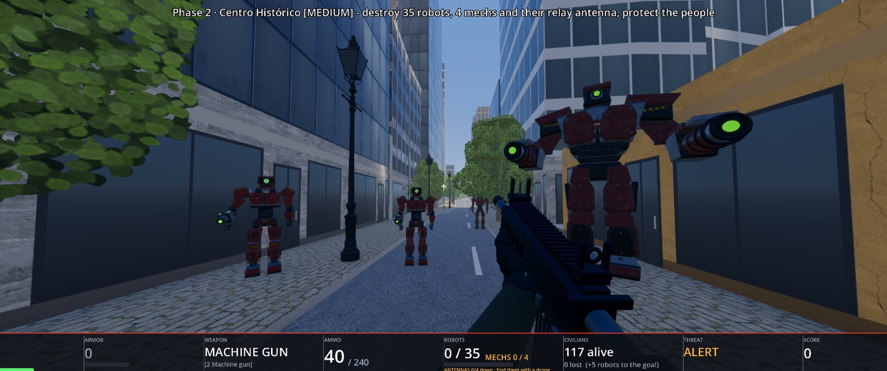

## The game

- **Each phase** asks you to bring down a number of robots and mechs and the
  robots' **relay antenna** hidden on a high roof - only a drone you fly can
  spot it. Then the exit to the next phase opens.
- **Protect the people.** The Coletores (URB-C4) grab lone pedestrians and
  carry them to **people containers**; bring a Coletor down to free its
  captive, open a container to free everyone, before the mothership lifts it
  away. Every two people lost add a robot to the goal.
- **Fight** from empty hands (punches and kicks) up to pistols, a carbine,
  a revolver, a shotgun, the **laço** (it catches drones - then you fly
  them), a mech's own cannon, and the grenades of the resistance: the
  *Bergamota de Aço* and the *Porongo EMP*.
- **Drive anything**: cars, buses, motorbikes, bicycles, horses - and the
  armoured combine harvester, whose reel shreds robots.
- **The field tablet** (T): a GPS that routes you along the streets to
  pharmacies, markets and repair shops, the radio, and **Bah**, an AI
  assistant who answers questions about the game.
- **Robot parts** from downed robots are traded at repair shops
  (assistências técnicas) for gadgets: information glasses, drones, the GPS
  upgrade, grenades.
- **Online**: co-op over the internet, reports from the pause menu, and
  **mods** - maps other players changed, installed from the title screen.

The full rules, keys and numbers are in [docs/GAMEPLAY.md](docs/GAMEPLAY.md).

## Screenshots

<table>
  <tr>
    <td width="50%">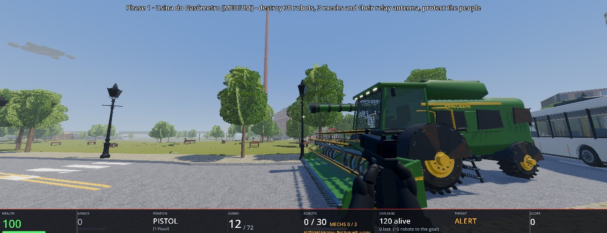<br><sub>The armoured combine harvester waits near the start of every phase</sub></td>
    <td width="50%">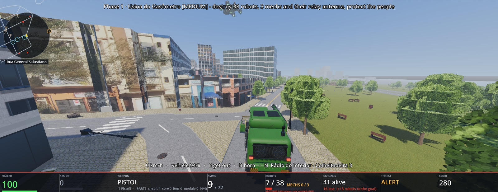<br><sub>Driving it through the Gasômetro: real facade photos, the corner map, a ship overhead</sub></td>
  </tr>
  <tr>
    <td width="50%">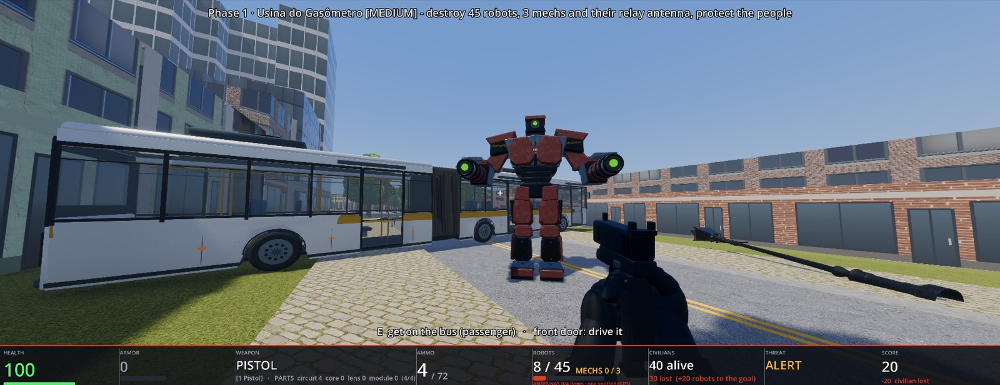<br><sub>A URB-H9 mech next to an articulated bus - any vehicle can be taken</sub></td>
    <td width="50%">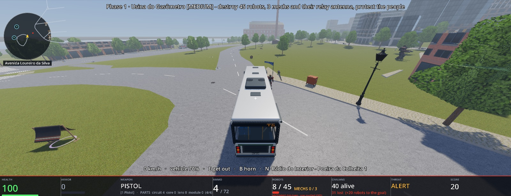<br><sub>Driving the bus down the Avenida Loureiro da Silva, the Usina behind</sub></td>
  </tr>
  <tr>
    <td width="50%">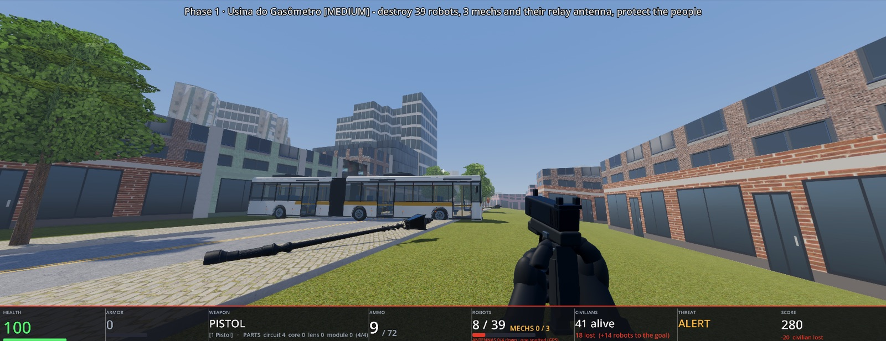<br><sub>Vehicles knock street lamps over</sub></td>
    <td width="50%">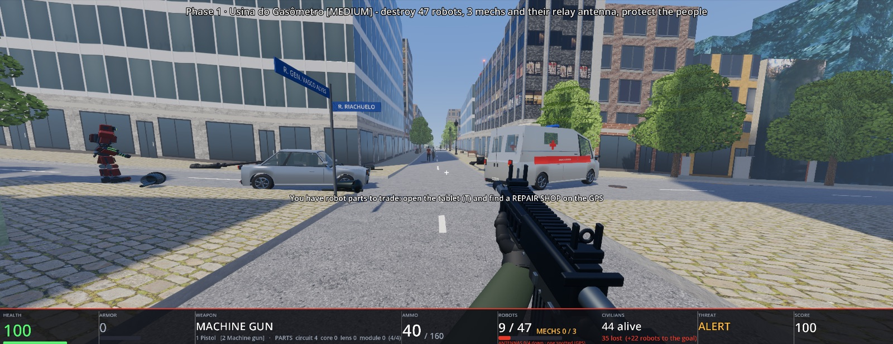<br><sub>Street name signs from OpenStreetMap at every corner</sub></td>
  </tr>
  <tr>
    <td width="50%">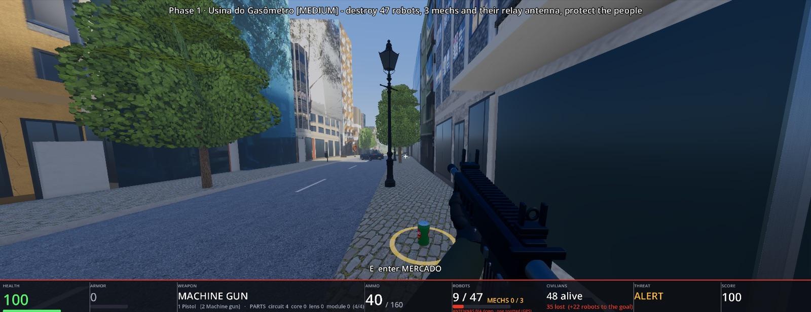<br><sub>A Fruki at a market's door; shops you can walk into</sub></td>
    <td width="50%">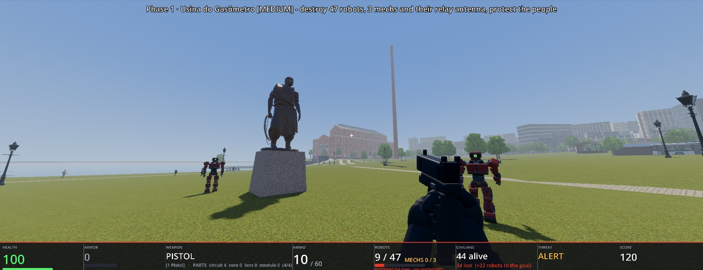<br><sub>The Laçador statue, robots on the lawn, the Guaíba on the left</sub></td>
  </tr>
  <tr>
    <td width="50%">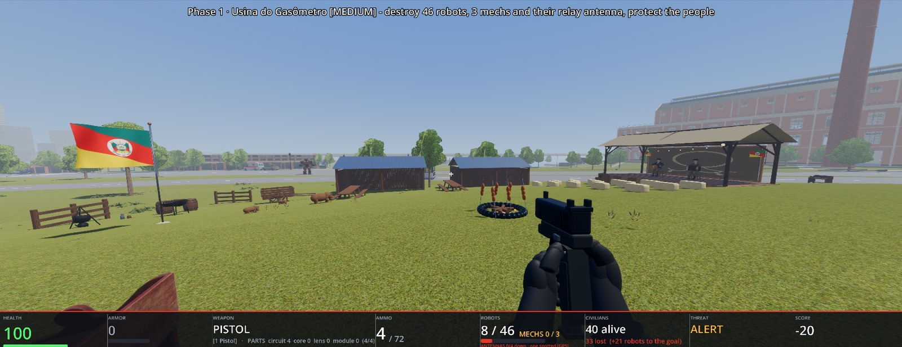<br><sub>The Acampamento Farroupilha: fogo de chão, musicians on the stage, the flag</sub></td>
    <td width="50%">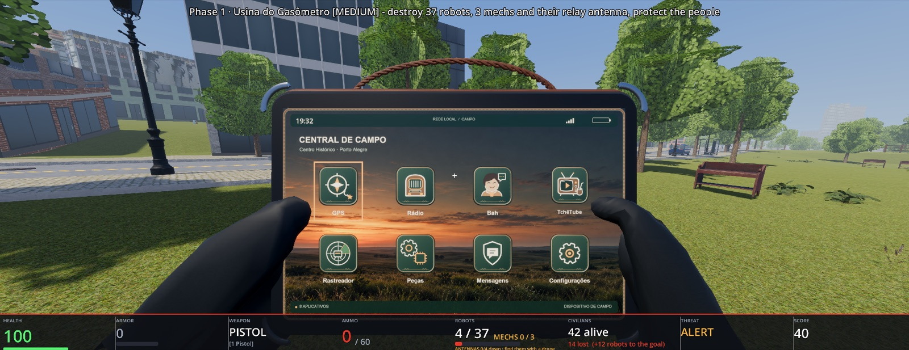<br><sub>The field tablet: GPS, radio, Bah the AI assistant, TchêTube...</sub></td>
  </tr>
  <tr>
    <td width="50%">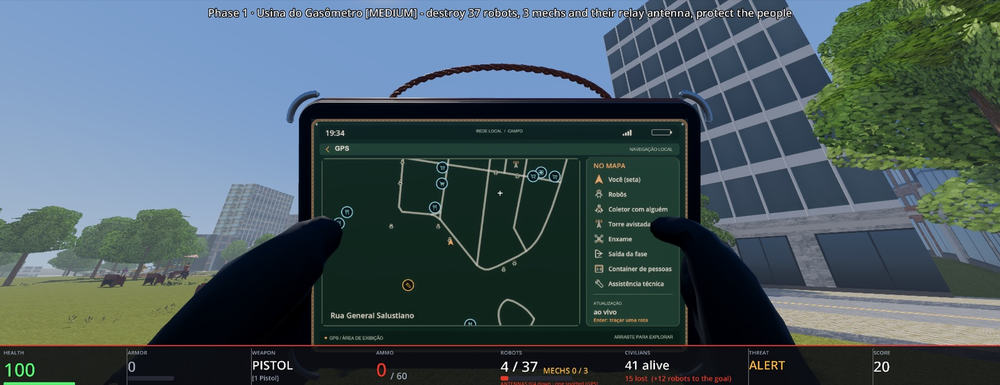<br><sub>The GPS: robots, shops and repair shops, routes along the streets</sub></td>
    <td width="50%">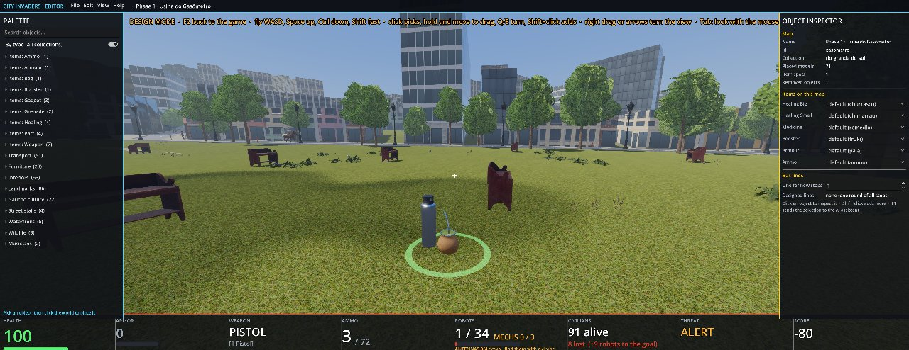<br><sub>A chimarrão (healing) placed in a park with the map editor</sub></td>
  </tr>
  <tr>
    <td width="50%">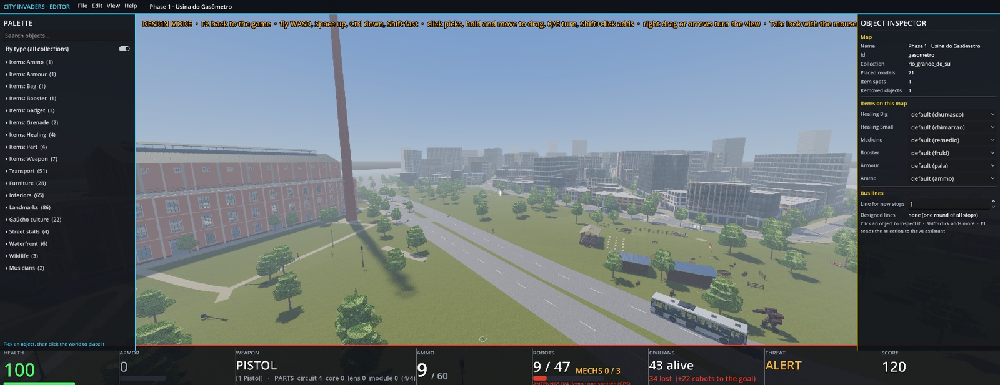<br><sub>The editor flying over the Gasômetro towards the Centro</sub></td>
  </tr>
</table>

## Maps

| Map | Where (Porto Alegre) |
|---|---|
| `gasometro` | Phase 1 - Usina do Gasômetro and the Guaíba shore |
| `centro` | Phase 2 - Centro Histórico: Praça da Alfândega, Sulacap, Cine Imperial |
| `mercado` | Phase 3 - Mercado Público and Paço Municipal |
| `poa` | free play - the whole Centro in one map |

Neighbouring phases overlap: leaving through a phase's exit you arrive at
the same corner of the next map.

**Import a new city** - one command, or *Studio > Import a new city* on the
title screen: it geocodes the place, downloads OpenStreetMap, terrain and
street photos, builds the facades and one map per phase, and lists it in
the menu.

```bash
tools/.venv/bin/python tools/map/new_city.py "Bielefeld, Altstadt" --name bielefeld --size 400 --phases 2
```

The facade photos come from [Mapillary](https://www.mapillary.com): create
a free account, register an application under *Dashboard > Developers* and
put its client token in `.env` at the repository root as
`MAPILLARY_TOKEN="MLY|..."`. Without it, `--no-photos` builds the city with
generated facades. An AI agent can do the whole import:
[AGENTS.md, "Importing a new city"](AGENTS.md#importing-a-new-city).

**Improve a map:**

- **The map editor in the game** (F2 in a round, or *Studio > Edit this
  phase*): place models from the palette - landmarks, furniture, vehicles,
  items, musicians - move and turn them, set what each item role is on this
  map, bus lines, remove what doesn't belong. Edits are saved in
  `maps/<map>/user/` and survive rebuilds, and *File > Share these edits as a
  mod* publishes them.
- **Your own facade photos and building heights**: `tools/map/building_photo.py`
  - `pick` finds the wall at a point, `photo` puts your picture on it,
  `height` fixes a building's height, `rebuild <map>` builds the map again.
- **Landmark models** on a building's OSM footprint, interiors and shops you
  walk into ([docs/ARCHITECTURE.md](docs/ARCHITECTURE.md), [docs/ASSETS.md](docs/ASSETS.md)).

How a real city becomes a map, step by step: [docs/MAP_PIPELINE.md](docs/MAP_PIPELINE.md).

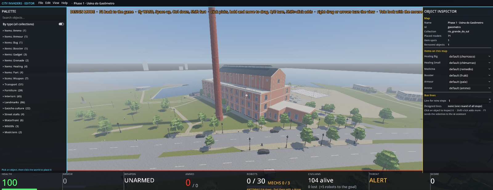

## Build it with us

City Invaders is open source and made to grow with its players. You don't
need to be a game developer to leave your mark:

- **Your city.** Any place mapped in OpenStreetMap becomes a playable map:
  your street, your neighbourhood, your town's square and landmarks, with
  real street photos on the facades. One command, or *Studio > Import a new
  city* in the game.
- **New phases.** Chain maps into a campaign across a city, set each phase's
  goals and its exit to the next.
- **Make a map feel like the real place.** Your own photos of the facades,
  the right building heights, the landmark everybody knows, the shop on the
  corner, the people and music on the square - with the in-game map editor
  (F2).
- **The game itself.** Weapons, robots, vehicles, gadgets, the tablet's apps,
  the AI of people and robots, performance, the online services.
- **Models, sounds and art** under a free licence, especially the places and
  culture of your region.

**Share a mod - no code, no GitHub.** The quickest way to contribute is
right inside the game. Change a map with the editor (F2): place monuments,
a camp, street furniture, musicians, items; set the bus lines; put your own
photos on the walls; remove what doesn't belong. Then *File > Share these
edits as a mod*: it goes to the City Invaders server, is reviewed, and once
published every player can install it from *Mods* on the title screen (and
remove it again, their own edits kept). Mods carry only map edits and
photos, never code, so installing one is safe. The best mods can become
part of the official maps. How it works: [docs/MODDING.md](docs/MODDING.md).

**Work with an AI agent.** Much of this game was built with AI coding agents
(Claude Code, Codex), and yours is welcome: Claude Code, Codex, Cursor,
Gemini or any other. Point it at [AGENTS.md](AGENTS.md) - the rules, how to
import a city, how to test in the game through the DevAgent (the agent can
play the game, look at it and check its own work), and an index of the
repository. Setup per tool is in [docs/AGENTS.md](docs/AGENTS.md).

**Send it as a pull request.** Fork the repository, make your change on a
branch, test it in the game, and open a pull request with a short
description and screenshots. We review every contribution and merge it into
the game once it is ready. How, and what a new city's pull request
contains: [CONTRIBUTING.md](CONTRIBUTING.md). Ideas and bugs are welcome as
issues too.

## Quick start

You need [Git LFS](https://git-lfs.com) (`brew install git-lfs`, then
`git lfs install` once) and [Godot 4.7](https://godotengine.org) on the PATH
as `godot`. The models, textures, sounds and maps (~4 GB) come through Git
LFS from the project's own server, `lfs.cityinvaders.vgdata.net` - no
account needed.

```bash
git clone https://github.com/vgartner/city-invaders.git
cd city-invaders
cd godot && godot --headless --path . --import && cd ..    # once, a few minutes
./run-godot.sh                                             # macOS / Linux
```

On Windows (or to start it by hand): `godot --path godot -- --devagent`;
without `-- --devagent` it is the game a player gets, with no developer keys.

For the map pipeline and the tools you also need Python 3.12+:

```bash
python3 -m venv tools/.venv
tools/.venv/bin/pip install numpy shapely trimesh pillow scipy requests duckdb
```

## Developing, alone or with an AI agent

`./run-godot.sh` starts the game with the **DevAgent**: a local remote
control (port 24690) through which scripts and AI agents play the game,
take screenshots, read its state and test changes. It also adds developer
keys, listed in a panel when the first round starts:

| Key | |
|---|---|
| F1 | chat with your AI assistant - your position, view and selection go along |
| F2 | design mode: the map editor over the frozen round |
| F3 | god mode |
| F5 | record performance; the assistant analyses the log |

How to work with an AI agent and send changes: [Build it with us](#build-it-with-us).

## Documentation

| Document | For |
|---|---|
| [docs/GAMEPLAY.md](docs/GAMEPLAY.md) | controls, weapons, pickups, the enemy, score, the tablet, the editor |
| [docs/ARCHITECTURE.md](docs/ARCHITECTURE.md) | how the game is put together: scripts, networking, collision layers, landmarks |
| [docs/ENTITIES.md](docs/ENTITIES.md) | the data-driven objects (`*.def.json`): weapons, items, robots, people |
| [docs/MAP_PIPELINE.md](docs/MAP_PIPELINE.md) | turning a real city into a map; your own photos, heights and models |
| [docs/ASSETS.md](docs/ASSETS.md) | model conventions, rigs and clips, the Blender scripts |
| [docs/DEVAGENT.md](docs/DEVAGENT.md) | driving the game from scripts and AI agents; the autoplay bot |
| [tools/video/README.md](tools/video/README.md) | gameplay video rules, recording workflow, interaction checks and delivery |
| [docs/PERFORMANCE.md](docs/PERFORMANCE.md) | frame-rate budget, how to measure, findings |
| [docs/ONLINE.md](docs/ONLINE.md), [docs/MODDING.md](docs/MODDING.md) | Bah, reports, mods; the server side is in `server/README.md` |
| [docs/BUILDING.md](docs/BUILDING.md) | exporting a release (Windows `.exe`) |
| [docs/ROADMAP.md](docs/ROADMAP.md), [docs/IDEAS.md](docs/IDEAS.md) | where the project is going |
| [docs/LICENSING.md](docs/LICENSING.md), [godot/assets/CREDITS.md](godot/assets/CREDITS.md) | licences of the data and assets, their sources |
| [AGENTS.md](AGENTS.md), [docs/AGENTS.md](docs/AGENTS.md) | for AI coding agents: rules, testing, a file index, setup per tool |
| [CONTRIBUTING.md](CONTRIBUTING.md) | how to contribute maps, models and code |

## Repository layout

- `godot/` – the game: `scripts/` (GDScript), `assets/` (models, textures,
  sounds, entity definitions), `city/` (generated maps - rebuilt, not edited)
- `maps/<map>/` – each map's sources: `build.json`, OSM data, photos, and
  your additions in `user/`
- `tools/` – `map/` (the map pipeline), `devagent/` (remote control, MCP
  server), `bench/` (benchmarks, autoplay report), `blender/` and `assets/`
  (scripts that make the models and sounds)
- `server/` – the online services (API, Bah, the Git LFS server)
- `docs/` – the documentation above

## Data licences

- Map data © OpenStreetMap contributors (ODbL)
- Street-level imagery © Mapillary contributors (CC-BY-SA 4.0)
- Landmark photos: Wikimedia Commons contributors (see `maps/*/facades/commons_credits.txt`)
- Elevation: Copernicus GLO-30 DEM

Code: GNU GPL v3 ([LICENSE](LICENSE)); assets and maps: CC BY-SA 4.0; see [docs/LICENSING.md](docs/LICENSING.md).
